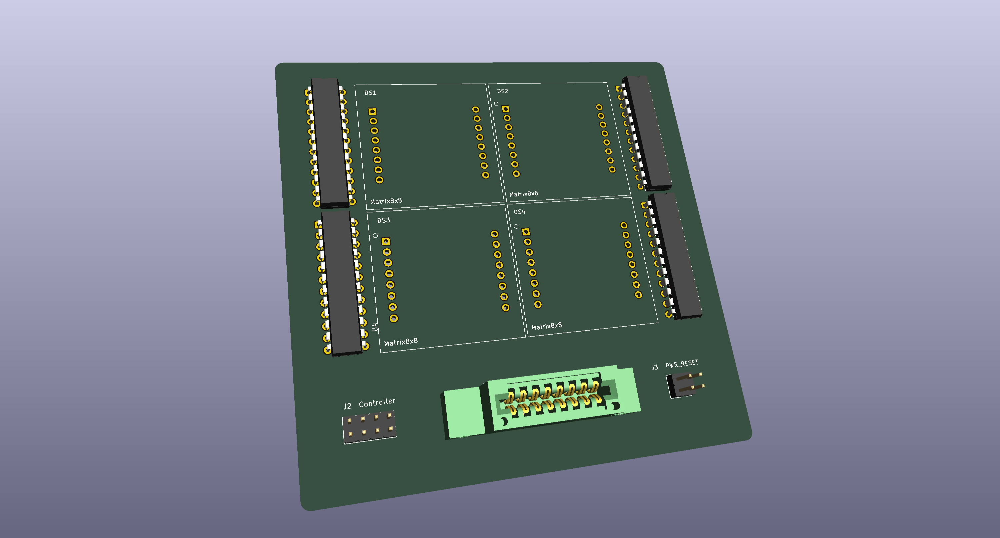
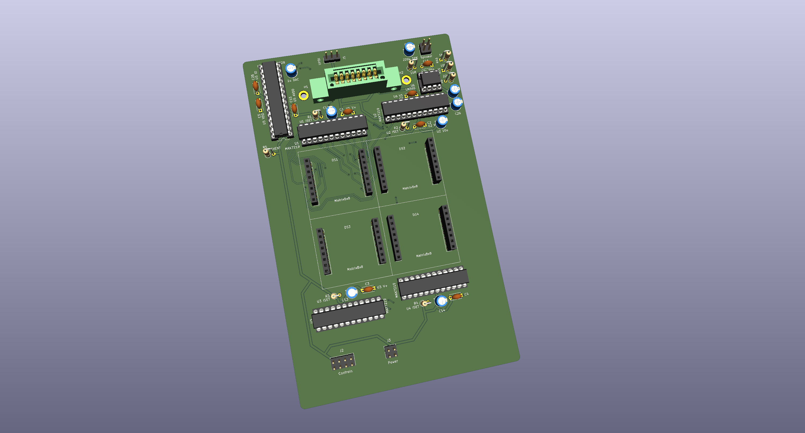
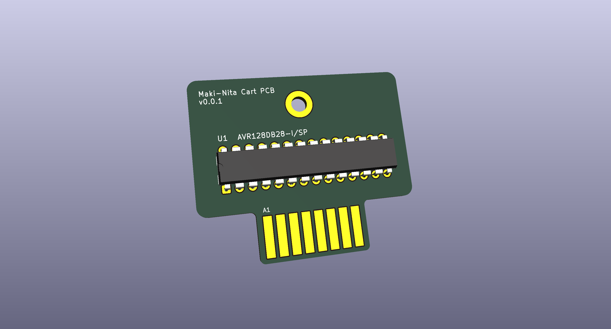
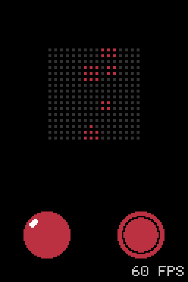

Maki-Nita is a one-stick, one-button portable tabletop arcade. The name comes from _maquinita_, the Mexican word generally used for an arcade machine. The display is four white 8x8 LED matrices in a 16x16 field. Graphics are 1-bit (LEDs are either ON or OFF). Magnavox Odyssey-style colored sheets in front of that field carry scenery and color (the overlay is an extension of the cartridge, part of the game experience). A magnetic marquee runs along the top and the cartridge sits behind that header. The [overlays](docs/overlays.md) and [hardware](docs/hardware.md) docs describe the sheet and the cabinet.

An AVR128DB28 on a cartridge runs the game and holds the picture (the cartridge is both the console brain and the game data). Four MAX7219 drivers refresh the screen grid.

## Goals

Simple graphics can still be fun. A stick (and sometimes a button) is all that's needed. Together with cartridges, colored overlays, and a sturdy design, that is the spirit of Maki-Nita.

The build is a simple soldering job.

- The parts are through-hole, on a 2.54 mm grid.
- The chips sit in sockets, so a bad one can be swapped.
- Wires leave the board on headers. One is the controls. One is power and reset. One is the speaker.

The parts are cheap.

- The console is a 100x160 mm Eurocard 3U board (DIN 41494, IEC 60297). That size is a common rack standard. The cartridge is a small 2-layer board.
- The screen is four white/neutral-white 8x8 LED matrices (normally less than 1 USD each), and the chips are commonly available parts.

- Power is any generic/regulated 5 V adapter.

Software is under the MIT License. The hardware design is under the CERN Open Hardware Licence Version 2, Strongly Reciprocal.

## Settled choices

- Display: 16x16, four common-cathode 8x8 white or neutral-white matrices, one bit per pixel. Only white emitters support the colored sheet in [overlays](docs/overlays.md). The faceplate accepts that sheet. A title runs with no sheet installed.
- Board: a 2-layer console PCB and a 2-layer cartridge, each with a ground pour on both sides. The console carries the matrices, the drivers, the cart socket, the audio AVR, and the amplifier.
- CPU: AVR128DB28-I/SP on the cartridge, internal 24 MHz clock. The console socket is an EDAC 345-016-520-212, 16 contacts, 8 a side.
- Drivers: four MAX7219ENG+ or MAX7219CNG+, one per 8x8 block.
- Power: regulated 5 V barrel jack and a panel switch. The rail and reset enter the console on a 2x2 header.
- Controls: one arcade stick (four switches) and one 30 mm button.
- Sound: a second AVR128DB28 on the console mixes a square wave, a triangle, and noise. The cartridge sends one index byte into a catalog of 256 sounds. An LM386N-1 drives an 8 ohm speaker on a 2x2 header. A game may use music, effects, both, or neither.
- Cabinet: magnetic marquee with a few backlight LEDs. Playfield background LEDs turn on when the marquee is seated. The cartridge case in the marquee bay is 50x40 mm. Details are in [hardware](docs/hardware.md).

## PCBs

These are early designs and are subject to modifications. Copper traces are not finished yet. That said, the [full netlist](tools/kicad) is already defined and in constant review.

Main system PCB, 100x160 mm Eurocard 3U (DIN 41494, IEC 60297). With and without the LED matrices:

Cartridge PCB, 44x37 mm (50x40 mm plastic case):

## Simulator

At the hardware layer, `tools/sim` is a **netlist simulation** of the console. Named nets tie IC pins together like the schematic. The MAX7219 chain, matrix segment and digit lines, and EVENT wiring include chip behavior that mimics the real system.

So the app is a **simulator**, not only an emulator: the same game C as the cartridge firmware runs on the host and drives that netlist. AVR `.hex` files are not executed. The stick and button, the display chain (DIN, CLK, LOAD), EVENT to the audio path, and the shared catalog in `tools/fw/synth.c` all hang off that model.

The console circuit is also written in **SKiDL** (`tools/kicad/skidl/maki_nita.py`). `tools/kicad/skidl/export_netlist.sh` exports the KiCad netlist and net classes into `tools/kicad/skidl`, which seeds the base schematic and PCB structure. Component placement, copper traces, etc, are still manual work on top of that import.

Sound on EVENT uses the same pulse timing as hardware (100 us and 200 us lows, sampled at 40 kHz). SDL drives the speaker net from that model. A second small window shows the 32x32 VRAM grid and the center 16x16 region is the picture sent to the matrices.

`./sim.sh` builds `tools/sim/maki-nita-ui` and opens the UI. The active cart comes from `cart_placed.json` (for now only `space-shooter`, `paddle`, or `arkaled`). More detail is in [software](docs/software.md).

## Docs

- [Hardware](docs/hardware.md) covers the console PCB, the pours, the cabinet, and where each part sits.
- [Overlays](docs/overlays.md) covers white light on the field, colored sheets, and cart-linked scenery.
- [Video](docs/video.md) covers the matrices, the drivers, the cart edge, and power.
- [Audio](docs/audio.md) covers EVENT, the console AVR, the amplifier, and the speaker.
- [Input](docs/input.md) covers the stick, the button, and their header.
- [Software](docs/software.md) covers one tick, the framebuffer, the inputs, the sound catalog, and what a game is.
- [SDK](docs/sdk.md) covers entities, shapes, and collision.
