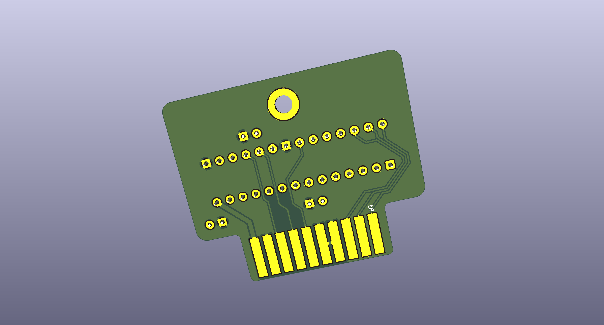
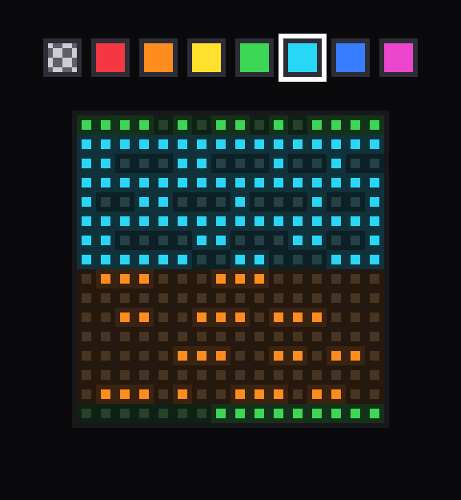
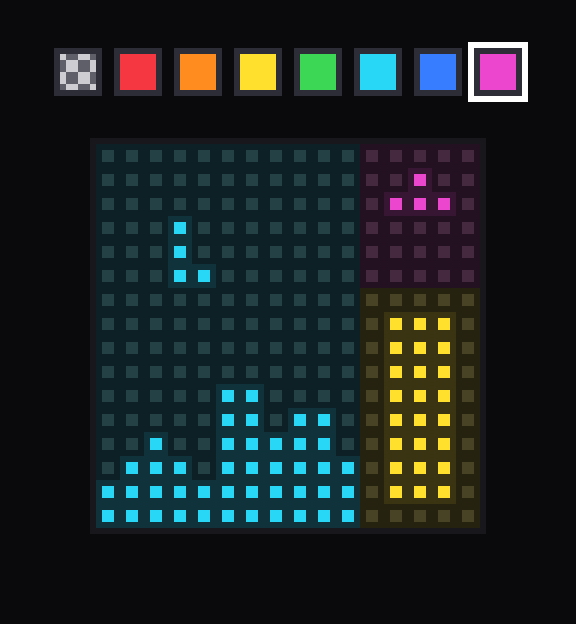
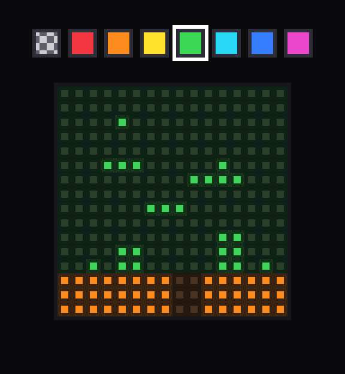

Maki-Nita is a cartridge-based, two-player portable tabletop Arcade. The name comes from _maquinita_, the Mexican word generally used for an arcade machine. The display is four white 8x8 LED matrices in a 16x16 field. Graphics are 1-bit (LEDs are either ON or OFF).

On a similar spirit as the Magnavox Odyssey and the Vectrex, Maki-Nita uses colored, translucent sheets to cover the screen. So the overlay is an extension of the cartridge, part of the game experience. A magnetic marquee runs along the top and the cartridge sits behind it. The [overlays](docs/overlays.md) and [design](docs/design.md) docs cover the sheet and the console netlist.

An AVR128DB28 on a cartridge runs the game and holds the picture (the cartridge is both the system brain and the game data). Four MAX7219 drivers refresh the screen grid.

## Goals

Simple graphics + simple input can still be fun. A stick (and sometimes a button) is all that's needed. Together with cartridges, colored overlays, and a sturdy design, that is the spirit of Maki-Nita.

The build is a simple soldering job.

- Parts are through-hole, on a 2.54 mm grid.
- Chips sit in sockets, so a bad one can be swapped.
- Wires leave the board on headers. Two for player controls, another one for power/reset, and one more for the speaker.

Parts are cheap.

- The console is a two-layer 100x100 mm board (~5 USD + shipping). The cartridge is an even smaller PCB.
- The screen is four white 8x8 LED matrices (normally less than 1 USD each), and the chips are commonly available (not EOL or NRND).

- Power is any generic/regulated 5 V adapter.

Software is under the MIT License. The hardware design is under the CERN Open Hardware Licence Version 2, Strongly Reciprocal.

## PCBs

Copper tracing is pending for the main PCB, but the full [SKiDL netlist](tools/kicad/main-pcb/skidl/maki_nita.py) and KiCad files are already under `tools/kicad/main-pcb/` and `tools/kicad/cart-pcb/` (not tested IRL).

Main system PCB, 100x100 mm:

Cartridge PCB, 44x37 mm:

## Game simulator

`tools/sim` is a netlist simulation of the console. The simulator compiles the cartridge's C game code natively on the host to drive the hardware model. This same C code can be directly flashed to the AVR on the cartridge.

SKiDL export writes `tools/kicad/main-pcb/skidl/maki-nita.net` and updates net classes in `tools/kicad/main-pcb/maki-nita.kicad_pro`. See [firmware](docs/firmware.md).

`./sim.sh` opens the UI. The active cart is named in `cart_placed.json`.

## Overlay simulator

This is a small tool to simulate (paint) a game screen with an overlay on top of it. It will soon be integrated into the Game simulator:

## Docs

- [Design](docs/design.md) is the console netlist, cart edge, display chain, and audio wiring from SKiDL and KiCad.
- [Firmware](docs/firmware.md) is the game loop, inputs, sound, SDK, and simulator.
- [Overlays](docs/overlays.md) is the colored sheet in front of the field.

## Future plans

Once the base design has been proven/tested, these are the next things to look at:

* Translucent art for the marquees and backlight LEDs to make it shine, as in real classic arcades.
* Better audio quality by using the AKWF (Adventure Kid Waveforms) library. Samples would live in the Audio AVR and be triggered via the already defined EVENT signal.
* USB C power port as an alternative to the barrel (maybe a switch to pick one or the other, or priority-based).
* In the long run, maybe a "high-res" version of the Maki-Nita system (16 matrices, 32x32 screen). It could be retro-compatible with 16x16 games, by doubling pixels to 2x2 regions.

