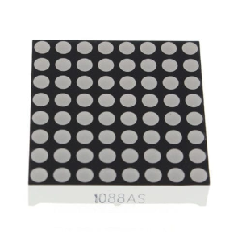
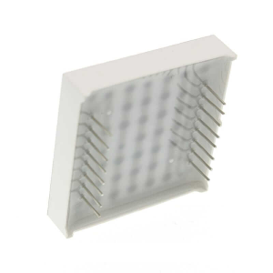

Maki-Nita is a one-stick, one-button portable tabletop arcade. The name comes from _maquinita_, the Mexican word generally used for an arcade machine. The display is four 8x8 LED matrices, set as a 16x16 field. Graphics are 1-bit (LEDs are either ON or OFF).

An AVR128DB28 on a cartridge runs the game and holds the picture (the cartridge is both the console brain and the game data). Four MAX7219 drivers refresh the screen grid.

## Goals

Simple graphics can still be fun. A stick (and sometimes a button) is all that's needed. That, together with cartridges and a sturdy design, is the spirit of Maki-Nita.

The build is a simple soldering job.

- The parts are through-hole, on a 2.54 mm grid.
- The chips sit in sockets, so a bad one can be swapped.
- Wires leave the board on headers. One is the controls. One is power and reset. One is the speaker.

The parts are cheap.

- The console is a 100x160 mm Eurocard 3U board (DIN 41494, IEC 60297). That size is a common rack standard. The cartridge is a small 2-layer board.
- The screen is four 8x8 LED matrices (normally less than 1 USD each), and the chips are commonly available parts.
- Power is any generic/regulated 5 V adapter.

Software is under the MIT License. The hardware design is under the CERN Open Hardware Licence Version 2, Strongly Reciprocal.

## Settled choices

- Display: 16x16, four common-cathode 8x8 matrices, one bit per pixel.
- Board: a 2-layer console PCB and a 2-layer cartridge, each with a ground pour on both sides. The console carries the matrices, the drivers, the cart socket, the audio AVR, and the amplifier.
- CPU: AVR128DB28-I/SP on the cartridge, internal 24 MHz clock. The console socket is an EDAC 345-016-520-212, 16 contacts, 8 a side.
- Drivers: four MAX7219ENG+ or MAX7219CNG+, one per 8x8 block.
- Power: regulated 5 V barrel jack and a panel switch. The rail and reset enter the console on a 2x2 header.
- Controls: one arcade stick (four switches) and one 30 mm button.
- Sound: a second AVR128DB28 on the console mixes a square wave, a triangle, and noise. The cartridge sends one index byte into a catalog of 256 sounds. An LM386N-1 drives an 8 ohm speaker on a 2x2 header. A game may use music, effects, both, or neither.

## PCBs

These are early designs and are subject to modifications. No copper traces yet, but the netlist is defined in the [kicad](tools/kicad) folder.

Main system PCB, 100x160mm Eurocard 3U (DIN 41494, IEC 60297):

Cartridge PCB, 44x47mm. Designed to fit inside a 50x50mm cart case:

8x8 matrix:

## Docs

- [Hardware](docs/hardware.md) covers the console PCB, the pours, and where each part sits.
- [Video](docs/video.md) covers the matrices, the drivers, the cart edge, and power.
- [Audio](docs/audio.md) covers EVENT, the console AVR, the amplifier, and the speaker.
- [Input](docs/input.md) covers the stick, the button, and their header.
- [Software](docs/software.md) covers one tick, the framebuffer, the inputs, the sound catalog, and what a game is.
- [SDK](docs/sdk.md) covers entities, shapes, and collision.
- `./sim.sh` builds `tools/sim/maki-nita-ui` and opens the window. A smaller window beside it shows the 32 by 32 grid. The cart in `cart_placed.json` is the game that runs.
