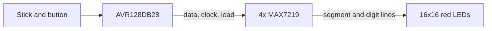

# RetroDiode hardware

RetroDiode is one board. The LED field fills the top. A strip along the bottom holds the four display drivers, the CPU, the power parts, and the headers. The field is square. The strip makes the board a little taller than that square. Pitch is still open, so the outline in mm is still open.

The field is 256 red 5 mm LEDs on one even pitch. Electrically it is four 8x8 blocks. The pitch does not change at the block boundaries.

The stick and the button mount to the case. A header on the bottom edge of the strip is where their wires land.

## Who turns a pixel on

The AVR keeps the frame in RAM. It sends that frame to the drivers when the picture changes. Each MAX7219 stores one 8x8 block and scans it on its own. A segment pin sources an LED anode. A digit pin sinks an LED cathode. A lit pixel is one segment bit set in that digit's register.

| Block | Columns | Rows | Place in the chain |
| --- | --- | --- | --- |
| Top left | 0 to 7 | 0 to 7 | First. DIN comes from the AVR |
| Top right | 8 to 15 | 0 to 7 | Second |
| Bottom left | 0 to 7 | 8 to 15 | Third |
| Bottom right | 8 to 15 | 8 to 15 | Fourth. End of the chain |

Column 0 is the left of the screen. Row 0 is the top. Inside a block, the same rule holds. The block's own column 0 is its left edge, and its own row 0 is its top edge.

DOUT of one driver feeds DIN of the next. CLK is common. LOAD is common. DOUT changes on the falling edge of CLK. A bit at DIN is valid at DOUT 16.5 clock cycles later. In a four-driver transfer, the first 16-bit word is the word the last driver latches.

## Parts

The AVR128DB28-I/SP and the MAX7219ENG+ are in production.

| Qty | Part | Role |
| --- | --- | --- |
| 1 | AVR128DB28-I/SP | CPU. 128 KB flash, 16 KB RAM, 28-pin SPDIP |
| 1 | 28-pin DIP socket | For the CPU |
| 4 | MAX7219ENG+ | 8x8 common-cathode LED drivers, 24-pin DIP |
| 4 | 24-pin DIP sockets, 0.3 inch | For the drivers |
| 256 | Red 5 mm LED | The field |
| 4 | 28 kohm | ISET, one per driver. About 20 mA peak per LED |
| 1 | 10 kohm | RESET pull-up |
| 1 | 10 kohm | LOAD pull-up |
| 2 | 10 kohm | Pull-downs on DIN and CLK |
| 1 | 1N5822 | Series Schottky, reverse-plug protection |
| 1 | Polyfuse, 1.5 A hold | On the 5 V input |
| 1 | Barrel jack, 5.5 x 2.1 mm, center positive | Regulated 5 V in |
| 1 | SPST panel switch | Breaks the 5 V rail |
| 1 | 100 uF electrolytic | Bulk capacitor on the 5 V rail |
| 4 | 10 uF electrolytic | One from each driver V+ to GND, close to the package |
| 7 | 100 nF | One at each driver V+ pin, and at VDD, AVDD, and VDDIO2 |

VDD, AVDD, and VDDIO2 all tie to the 5 V rail. Port C takes power from VDDIO2. An open VDDIO2 pin leaves that port unpowered.

Each driver has two GND pins, 4 and 9. Both tie to ground. The 10 uF and the 100 nF for that driver sit between its V+ and GND, close to the package.

DIN, CLK, and LOAD are logic inputs with a high threshold of 3.5 V and a low threshold of 0.8 V. The AVR drives them from the same rail as the drivers.

Each ISET resistor sits between that driver's V+ and its ISET pin. For a red LED near 2 V, 28 kohm sets the peak segment current near 20 mA. The drivers also have a global intensity register. It stays at full scale (31/32). Games do not change it. A lit pixel then averages about 2.4 mA, because the driver scans one row of its block at a time.

## Block wiring

Segment pins are anodes, left to right. The digit byte matches that order. Bit 7 is the left pixel of the block.

| Column in the block | Segment pin | Bit |
| --- | --- | --- |
| 0 | DP | 7 |
| 1 | A | 6 |
| 2 | B | 5 |
| 3 | C | 4 |
| 4 | D | 3 |
| 5 | E | 2 |
| 6 | F | 1 |
| 7 | G | 0 |

Digit pins are cathodes, top to bottom. Digit 0 is the top row of the block.

| Row in the block | Digit pin | Register address |
| --- | --- | --- |
| 0 | DIG0 | 0x01 |
| 1 | DIG1 | 0x02 |
| 2 | DIG2 | 0x03 |
| 3 | DIG3 | 0x04 |
| 4 | DIG4 | 0x05 |
| 5 | DIG5 | 0x06 |
| 6 | DIG6 | 0x07 |
| 7 | DIG7 | 0x08 |

A segment that is off is pulled to GND. A digit that is off is pulled to V+.

On power-up the MAX7219 blanks the display, enters shutdown, sets the scan limit to digit 0 only, leaves decode off, and sets intensity to its minimum. Firmware writes scan limit, decode mode, and intensity before it leaves shutdown. The driver can take those writes while shutdown is still in force.

## Current

A full-white frame turns on every LED. Each driver lights one of its eight rows at a time, eight LEDs at about 20 mA, and blanks that row for 1/32 of the row time. One driver therefore draws about 155 mA for the LEDs. Four drivers draw about 620 mA. The dissipation formula in the driver datasheet uses 8 mA of logic current per driver, and the CPU draws under 20 mA, so the rest of the board is about 50 mA. The total is about 0.7 A.

The jack takes a regulated 5 V supply, 2 A. Center positive. The polyfuse, then the Schottky, then the panel switch, then the bulk capacitor. The Schottky drops about 0.4 V. The drivers are specified from 4.0 V to 5.5 V, so the rail near 4.6 V is in range.

At 20 mA and a red LED near 2 V, each DIP dissipates well under 1 W. The packages stay within their thermal rating on a full-white frame.

## CPU signals

Port pins on the AVR128DB28. Package pin numbers stay with the schematic, taken from the 28-pin SPDIP figure in the datasheet.

| Signal | Pin | Direction | Notes |
| --- | --- | --- | --- |
| DIN | PA4 | out | MOSI into the first MAX7219. 10 kohm pull-down. Idle low |
| CLK | PA6 | out | Rising edge clocks one bit. 10 kohm pull-down. Idle low |
| LOAD | PA7 | out | Rising edge latches the 16 bits in each driver's own shift register. 10 kohm pull-up. Idle high |
| UP | PD1 | in | Active low, internal pull-up |
| DOWN | PD2 | in | Active low, internal pull-up |
| LEFT | PD3 | in | Active low, internal pull-up |
| RIGHT | PD4 | in | Active low, internal pull-up |
| BUTTON | PD5 | in | Active low, internal pull-up |
| RESET | PF6 | reset | 10 kohm pull-up. Stays a reset pin |
| UPDI | UPDI | program | Programming header |

PA0, PA1, PA2, PA3, PA5, PC0, PC1, PC2, PC3, PD6, PD7, PF0, and PF1 stay free. PF0 and PF1 are the 32 kHz crystal pins, so they carry no loads.

The programming header is a 1x3: UPDI, VCC, GND. The board is powered from the barrel jack during programming.

## Controls

The stick is a Sanwa JLF or the same kind of part. Four independent switches. A diagonal is two switches closed at once. A square gate or an octagonal gate is a mechanical plate. The circuit is the same either way.

Every switch common ties to GND. The normally open contact ties to its signal pin. The button is the same kind of switch. One 6-pin header on the bottom edge: GND, UP, DOWN, LEFT, RIGHT, BUTTON.

## Still open

- LED pitch and the exact outline of the board.
- A case.
- A small speaker for beeps. It plays a triangle or a sine wave at a chosen frequency. The pin and the drive circuit are still open. The other spare pins stay free.
