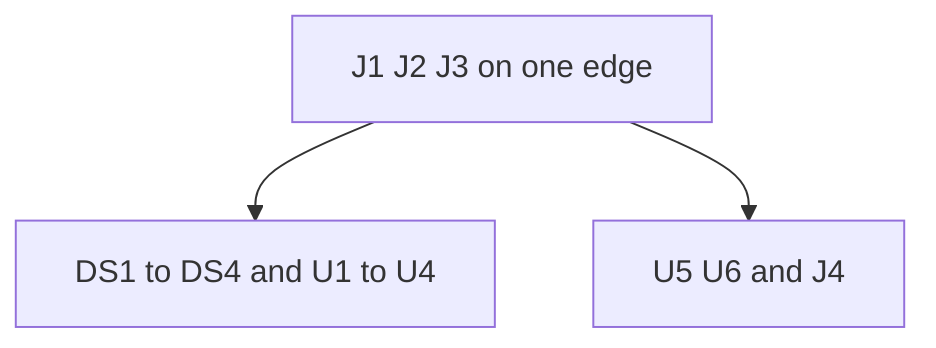

# Maki-Nita hardware

The console is one 100x160 mm 2-layer board. That size is Eurocard 3U, the common rack card in DIN 41494 and IEC 60297. The four matrices, the four drivers, the cart socket, the audio AVR, the amplifier, and the headers sit on that board. The game AVR sits on the cartridge. That board's U1 is the CPU. Console ICs start at U1. The video doc is the display chain and the cart edge. The audio doc is EVENT, the catalog, and the amplifier. The input doc is the stick and the button.

The console, the cartridge, and the rest of the hardware design are under the CERN Open Hardware Licence Version 2, Strongly Reciprocal.

The netlist is `tools/kicad/skidl/maki_nita.py`. The board is `tools/kicad/main-pcb`.

The overlays doc is the colored sheet in front of the field. The field uses white or neutral-white matrices so that sheet can filter color. The cabinet section covers the marquee and the cart bay.

## Board

The outline is 100x160 mm, corners radiused 2 mm. That is a single Eurocard 3U board, as DIN 41494 and IEC 60297 define it. Cases, card guides, and front panels for that size are common. Both sides carry a ground pour. Vias stitch the two pours. There is no +5 V pour. The 5 V rail is tracks.

Every part is through-hole. Chips sit in sockets. Axial resistors stand vertical on a 2.54 mm pitch.

A part that sits on Un uses n. A second part on that IC adds 10, a third adds 20. C1, C11, and R1 sit on U1. C5, C15, C25, C35, R5, and R15 sit on U5. C6, C16, C26, C36, C46, R6, R16, and R26 sit on U6.

The barrel jack, the polyfuse, the Schottky, and the panel switch sit off this board. The rail and reset enter on J3. The stick, the button, and the speaker mount to the case. Their wires land on J2 and J4.

A 4-layer stack with inner ground planes is a later step. The first board is this 2-layer pour. The audio doc is the check that decides whether a later stack is worth it.

## Field

DS1, DS2, DS3, and DS4 form a 2 by 2 field, about 64 mm square. The packages touch. Every matrix sits in the same orientation. DS1 is the top left. DS2 is the top right. DS3 is the bottom left. DS4 is the bottom right.

Each block is a white or neutral-white common-cathode 8x8 matrix. That emitter color feeds the overlay in the overlays doc.

The matrix body covers that 32 mm square. No other part sits under a matrix body. The sixteen pins are the only copper that belongs in that square.

U1 sits beside DS1. U2 sits beside DS2. U3 sits beside DS3. U4 sits beside DS4. Each driver owns the segment and digit traces of its own block. Those traces stay next to that pair. They do not cross the field to reach another block, and they do not wander through the audio chain.

Each driver has its own ISET resistor, one 10 uF, and one 100 nF. R1, C1, and C11 sit on U1. R2, C2, and C12 sit on U2. The same pattern holds for U3 and U4. Those three sit at that package, from V+ to GND. They do not sit at J3, and they do not sit in the audio cluster.

DIN, CLK, and LOAD leave J1 and enter U1. DOUT of one driver feeds DIN of the next. That chain runs left to right, then down a row. Those three nets run over the pour. They stay off AUD and AUDIN.

## Cabinet

The case layout is a small tabletop arcade. The playfield sits in the center. A marquee strip runs along the top. Controls sit below or beside the field.

The marquee is a removable panel, likely magnetic, like a mini arcade header. A few extra LEDs on the console backlight translucent art on that panel. Count, placement, drive, and diffuser are open.

When the marquee is seated, background illumination for the playfield turns on. That path uses white or neutral-white LEDs behind or around the matrices. Those LEDs stay off until the panel is in place. The sheet in [overlays](overlays.md) supplies color. The backlight supplies even white through the windows. Presence is likely sensed with a magnet in the marquee and a reed or Hall device on the console.

The cartridge inserts behind the marquee. The cart label or edge shows in the header area when a game is loaded, like a cabinet name above the glass. J1 stays on the console PCB. The case routes the cart into the marquee bay instead of leaving only the edge flush with the front face.

The plastic cartridge case is 50x40 mm. The cartridge PCB is 44x37 mm.

## Cart edge

J1, J2, and J3 sit on one edge so the cartridge and the case wires leave the board.

J1 is the EDAC 345 socket. The cart inserts from that edge. Side A faces the same way on the board as on the cartridge. The visible cart face sits in the marquee region above the field.

J2 sits next to J1. The stick and button wires are short. Pins 1 and 8 are GND, so those two wires leave beside ground.

J3 sits next to J1. Pin 2 is the 5 V rail. Pins 1 and 4 are GND. The reset switch leaves beside pin 4.

The game chip's UPDI header sits on the cartridge. That header does not sit on the console.

## Audio cluster

U5, U6, the DAC divider, and J4 form one cluster. That cluster sits off the field. It sits next to the cart edge or beside it. It does not sit between a driver ground pin and the matrices.

U5 and U6 sit next to each other. The DAC pin, C35, R6, R16, and the LM386 input form one short chain. LED return current does not cross the ground between those two packages.

J4 sits next to U6. The speaker return lands on pin 4. J4 does not sit on the far side of the field.

J5 sits next to U5. The board is powered from the barrel jack during programming.

U5 also owns global display brightness. A Bright button on the console ties to a free pin on U5, active low like the stick switches. While Bright is held, debounced Up and Down on J2 step through eight intensity values: 1, 3, 5, 7, 9, 11, 13, and 15. U5 writes that value to the Intensity register on all four MAX7219 parts when the level changes. The game AVR keeps sending digit and segment data over the cart edge. U5 only updates intensity, and only when the Bright control says so. Bright wiring, shared use of DIN, CLK, and LOAD, and the exact U5 pin are absent from the console netlist.

R5 sits on EVENT, near U5 pin 23 and cart contact B1. R15 sits on the DAC pin. R6 and R16 sit between C35 and U6 pin 3. R26 and C46 sit on the LM386 output. Those resistors stand vertical.

C5 sits across U5 pins 20 and 21. C15 sits across pins 14 and 15. C25 sits from pin 6 to pin 21. C6 and C16 sit across U6 pins 6 and 4. C26 sits from pin 7 to pin 4. Each +5 V pad joins the nearby IC pin with a short track. That pad does not take a long walk to a distant pad on the same net. The GND pad may use the pour. The return stays next to the IC ground pin.

C11 to C14, C16, C26, C35, and C36 are electrolytic. The positive pad of C35 faces the DAC. The positive pad of C36 faces the LM386 output. The positive pad of C26 faces pin 7.

LM386 pins 1 and 8 stay open.

The audio doc is the catalog, the pulses, and the amplifier values.

## Copper

Both pours stay one ground. Vias stitch them around U1 through U6. A via fence around the audio pair is enough. A split analog island that meets digital ground far away puts the LED pulse in series with the sample.

Four net classes sit on the board. 5V is the rail, 0.8 mm. AUDIO is DAC, AUD, AUDIN, AMP, SPK, ZOBEL, and BYPASS. MATRIX is the segment and digit lines from each driver to its block. Other nets stay in Default. GND is the pour.

A bypass cap joins the IC it sits on. The +5 V net has many pads. The nearest leftover pad on that net is not always the pin that cap belongs to.

AUD and AUDIN stay off DIN, CLK, and LOAD. A ferrite in the 5 V feed does not stop an 800 Hz tone from the drivers.

Traces from distinct signal classes do not run parallel or overlap across layers:

- High-speed digital lines (CLK, DIN, LOAD, DOUT) stay separated from sensitive audio traces (DAC, AUD, AUDIN, AMP) and driver bias pins (ISET). Parallel runs couple digital switching transients into the speaker and display current mirrors.
- Pulsed matrix lines (segment anodes and digit cathodes) carry up to 160 mA switched current. They stay confined to their local block and do not run beside audio traces or SPI control lines.
- Where digital control lines or matrix tracks must cross audio or ISET traces on the opposing copper layer, they cross strictly at 90 degrees. Parallel broadside routing on opposing layers is avoided to prevent capacitive crosstalk.
- High-impedance analog lines, including the DAC divider and LM386 inputs, stay as short as possible and remain shielded by the copper ground pour.

## Keep off the console

The game AVR does not sit on this board.

The barrel jack, the polyfuse, the Schottky, and the panel switch do not sit on this board.

No part sits under a matrix body.

The audio cluster does not sit under the field, and it does not sit in the LED return path between a driver and the matrices.

J4 does not sit away from U6.

Driver ISET and driver bypass parts do not sit in the audio cluster.

A 4-layer stack is not the first board.

Marquee backlight LEDs, marquee-present sense, playfield background LEDs, and the Bright control are absent from the console netlist in `tools/kicad/skidl/maki_nita.py`.

## Refs

| Ref | Sits |
| --- | --- |
| DS1 to DS4 | 2 by 2 field, packages touch |
| U1 to U4 | Beside that block |
| J1 | Cart edge |
| J2 | Cart edge, next to J1 |
| J3 | Cart edge, next to J1 |
| U5 | Off the field, next to U6 |
| U6 | Off the field, next to U5 |
| J4 | Next to U6 |
| J5 | Next to U5 |
| R1 to R4 | ISET, at that driver |
| C1 to C4 | 100 nF, at that driver |
| C11 to C14 | 10 uF, at that driver |
| R5, R15 | EVENT pull-up and DAC load, at U5 |
| C5, C15, C25 | Across the U5 rail pins |
| C35 | Between the DAC pin and the divider |
| R6, R16, R26 | Into U6 and the Zobel |
| C6, C16, C26 | Across the U6 pins |
| C36 | Between the LM386 output and J4 |
| C46 | With R26 at the LM386 output |
