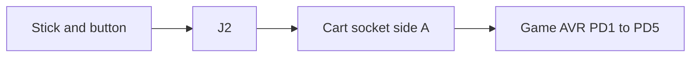

# Maki-Nita input

The stick and the button are the controls. They mount to the case. Their wires land on J2 and reach side A of the cart socket. The video doc lists the rest of that edge. The hardware doc is where J2 sits on the console.

The stick is a Sanwa JLF or the same kind of part. Four independent switches. A diagonal is two switches closed at once. A square gate or an octagonal gate is a mechanical plate. The circuit is the same either way.

The button is the same kind of switch, 30 mm across. Every switch common ties to GND. The normally open contact ties to its signal pin.

The five inputs are active low. The pin's own pull-up holds the line high. A closed switch ties the pin to GND. Up, down, left, right, and the button are PD1 through PD5, package pins 7 through 11.

| Signal | Package pin | Contact | Port |
| --- | --- | --- | --- |
| UP | 7 | A3 | PD1 |
| DOWN | 8 | A4 | PD2 |
| LEFT | 9 | A5 | PD3 |
| RIGHT | 10 | A6 | PD4 |
| BUTTON | 11 | A7 | PD5 |

## Debouncing

Every switch input uses the same rule at 60 Hz. Each tick samples the pin once. While the raw level matches the stable level, a counter stays at zero. When raw and stable disagree, the counter counts up. After two disagreeing ticks in a row, stable moves to raw and a pressed or released edge is recorded. That is about 33 ms of bounce before a change counts.

The game AVR applies this to the four stick directions and the action button through `input_tick` in `tools/fw/input.c`. The console AVR applies the same rule to the Bright button and to Up and Down while Bright is held for brightness. Left, Right, and the action button are ignored for brightness while Bright is down. The software doc lists the `Input` fields those edges feed.

## Brightness

Global matrix brightness is a console control, not a cart signal. A Bright button sits on the main board next to the stick wiring. While Bright is held, debounced Up steps to the next brighter level and debounced Down steps to the next dimmer level. The eight levels are 1, 3, 5, 7, 9, 11, 13, and 15 on the MAX7219 Intensity register. Zero is not offered. When Bright is released, Up, Down, Left, Right, and the action button return to the game on the cartridge. The audio AVR on U5 writes intensity to all four drivers when the level changes. During normal play the stick and button nets on J2 still reach the game AVR as in the table above.

## Header

J2 is a 2x4 pin header, 2.54 mm pitch. Pin 1 is the square pad.

| Qty | Part | Role |
| --- | --- | --- |
| 1 | Pin header, 2x4, 2.54 mm | Stick and button. J2 |

| Pin | Net |
| --- | --- |
| 1 | GND |
| 2 | +5 V |
| 3 | UP |
| 4 | DOWN |
| 5 | LEFT |
| 6 | RIGHT |
| 7 | BUTTON |
| 8 | GND |
