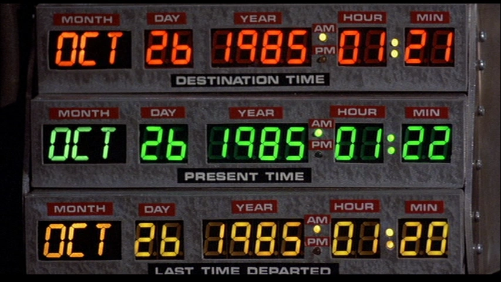
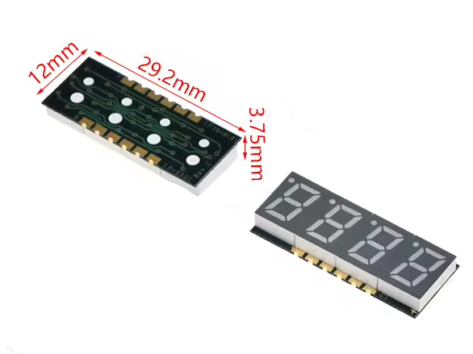
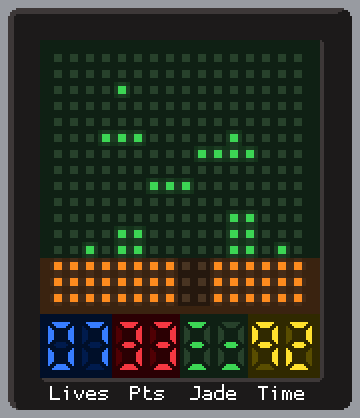

# Maki-Nita - Status Digits

Status: Design proposal  
Scope: Add a fifth MAX7219 (U7) by extending the display chain. This chip drives up to eight 7-segment digits for credits, lives, score, level, timer, or other numeric information. All eight digits route to a single pin header for flexible physical placement.

## 1. Goal

A fifth MAX7219 cascaded after the four matrix drivers provides eight 7-segment digits.

The visual style is designed to evoke the retro control panel digits from the Back to the Future movie, using similar display colors (such as red, green, and amber or yellow) across grouped digits, but without fixed printed labels. Omitting permanent functional labels on the cabinet faceplate allows each game cartridge to assign its own meaning to each digit cluster dynamically.



Typical allocations:

* Two digits for Credits (00 to 99)
* Two digits for Lives (00 to 99)
* Remaining four digits for score, level, timer, or high score

The hardware and low-level driver treat every digit as generic numeric display positions. Individual games assign specific meaning.


## 2. Hardware

While most components across the Maki-Nita system are through-hole parts for straightforward hand assembly, the 7-segment status display subsystem uses surface-mount passive display modules.

### 2.1 Driver IC (U7)

* Part: MAX7219ENG+ or MAX7219CNG+ in DIP-24 through-hole package
* Power: +5V and GND from the main system rail, decoupled with a 100 nF ceramic capacitor and a 10 uF electrolytic bulk capacitor
* ISET resistor: Set to match current requirements of the selected 7-segment modules

### 2.2 Chain Connection

The display chain extends through U7:

`Cart AVR -> U1 -> U2 -> U3 -> U4 -> U7`

* Signals DIN, CLK, and LOAD originate from cartridge pins PA4, PA6, and PA7.
* One board trace connects DOUT of U4 to DIN of U7.
* CLK and LOAD distribute in parallel across all five drivers.
* No additional edge connector pins are required on the cartridge interface.

### 2.3 Display Modules and Digit Connector

The status display subsystem settles on two passive 4-digit SMD modules (eight digits total), both emitting white light:

* Two 4-digit white SMD modules
* All color styling achieved through overlay filtering

These units are passive common-cathode SMD modules (29.2 mm x 12 mm x 3.75 mm) featuring castellated edge pads. Emitting pure white light allows the front overlay to tint each digit into any desired color scheme. Being passive, they contain no onboard controller and are wired directly to U7.



All eight digit cathode sinks (DIG0 through DIG7) and the eight segment anode drivers (SEGA through SEGG and DP) route to a single 2x9 male pin header (18 pins total). The displays mount to a small daughterboard or cabinet faceplate breakout and link to the main board through a ribbon cable.

| Pin | Signal | Pin | Signal |
|---|---|---|---|
| 1 | DIG0 | 2 | SEGA |
| 3 | DIG1 | 4 | SEGB |
| 5 | DIG2 | 6 | SEGC |
| 7 | DIG3 | 8 | SEGD |
| 9 | DIG4 | 10 | SEGE |
| 11 | DIG5 | 12 | SEGF |
| 13 | DIG6 | 14 | SEGG |
| 15 | DIG7 | 16 | DP |
| 17 | +5V | 18 | GND |

### 2.4 Auxiliary Expansion Header

A 2x6 pin male header provides general-purpose expansion signals:

* +5V and GND
* Unused GPIO lines from the audio microcontroller (U5)
* Optional I2C or SPI interface lines for external peripherals (such as EEPROM, real-time clocks, or auxiliary controls)

## 3. Firmware Architecture

Driver changes are located in cartridge firmware (`tools/fw/`).

### 3.1 Cascade Chain Configuration

In `flush.c`, the cascade chain count increases:

```c
#define CHAIN 5
```

Each transmission burst sends five 16-bit words. The fifth word targets U7.

### 3.2 Register Initialization for U7

During `drivers_init()`, U7 receives configuration appropriate for 7-segment numeric decoding:

| Register | Value | Function |
|---|---|---|
| Decode Mode (0x09) | 0x0F or 0xFF | Code-B decode enabled across active digits |
| Intensity (0x0A) | 0x0A to 0x0F | Brightness set independently from matrix panels |
| Scan Limit (0x0B) | 0x03 or 0x07 | Four digits (0x03) or eight digits (0x07) |
| Shutdown (0x0C) | 0x01 | Normal operation |
| Display Test (0x0F) | 0x00 | Normal display mode |

Matrix drivers U1 through U4 maintain raw segment bitmask mode (Decode Mode 0x00, Scan Limit 0x07).

### 3.3 Status Display API

```c
void status_credits(uint8_t value);
void status_lives(uint8_t value);
void status_set_digit(uint8_t digit, uint8_t code);
void status_set_pair(uint8_t pair, uint8_t value);
```

These functions update an internal RAM buffer. During the regular frame flush, `drivers_flush()` packs the status buffer into Code-B data bytes for transmission in the fifth word slot.

Games that omit status calls leave digits blank.

### 3.4 Frame Timing

Transmitting five words instead of four adds negligible overhead (under 10 us at 12 MHz SPI clock rates), fitting within the 16.6 ms (60 Hz) frame interval.

## 4. Mechanical and Visual Layout

* Driver U7 mounts in available PCB space adjacent to the matrix drivers using a standard DIP-24 through-hole footprint.
* The 2x9 header routes along the PCB periphery for ribbon cable clearance.
* The two 4-digit white display modules mount side by side on the front panel below the 16x16 matrix.
* The full-front overlay assembly (detailed in [overlays.md](overlays.md)) extends across both the 16x16 playfield and the eight status digits. A single rigid plastic frame holds a clear carrier acetate sheet with colored gel cutout pieces affixed on top, defining custom color zones across the four digit pairs (for example, blue, red, green, and yellow).
* Game labels (such as Lives, Pts, Jade, or Time) are applied as printed stickers on the plastic frame directly below the digits, providing high-contrast legends tailored to each title.
* Board mounting holes remain unobstructed.



## 5. Bill of Materials

Most parts are standard through-hole components, while the display modules are compact surface-mount units:

| Quantity | Item | Notes |
|---|---|---|
| 1 | MAX7219 DIP-24 | Through-hole display driver IC |
| 2 | 4-digit SMD 7-segment display (White) | Passive common-cathode SMD module (29.2 x 12 mm) |
| 1 | ISET resistor | Through-hole resistor tuned for display forward voltage |
| 1 | 100 nF ceramic capacitor | Through-hole decoupling capacitor |
| 1 | 10 uF electrolytic capacitor | Through-hole bulk power rail capacitor |
| 1 | 2x9 male pin header | 18-pin digit and segment interface |
| 1 | 2x6 male pin header | Auxiliary expansion interface |

## 6. Implementation Steps

1. Add U7 footprint and decoupling capacitors to the main board schematic.
2. Connect DOUT of U4 to DIN of U7, sharing CLK and LOAD.
3. Route U7 digit and segment pins to the 2x9 header.
4. Add the 2x6 auxiliary expansion header.
5. Update `CHAIN` to 5 in `tools/fw/flush.c` and expand `drivers_init()` and `drivers_flush()`.
6. Implement the status buffer API in `tools/fw/`.
7. Add simulation support in `tools/sim/` for fifth-driver telemetry.
