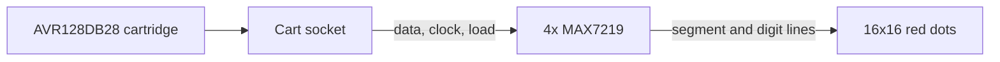

# Maki-Nita video

Maki-Nita is a console and a cartridge. Four red 8x8 matrices form a 2 by 2 field, about 64 mm square. The console carries the four display drivers, the cart socket, the power parts, and the headers. The cartridge carries the AVR128DB28 that holds the picture. That chip is the CPU. The hardware doc is the console PCB. The audio doc covers the console AVR and the amplifier. The input doc covers the stick and the button.

The builder solders the matrices. The drivers and the passives are parts on the console. The CPU is a part on the cartridge.

The console, the cartridge, and the rest of the hardware design are under the CERN Open Hardware Licence Version 2, Strongly Reciprocal.

Each matrix is a 16-pin common-cathode part, about 32 mm square. The packages touch. Rows are the cathodes. Columns are the anodes. Every matrix sits in the same orientation, so the same package corner points the same way on every block.

## Who turns a pixel on

The AVR keeps the frame in RAM and sends that frame to the drivers. It does not drive an LED pin.

The three outputs are the display chain. DIN is PA4, package pin 26, and it idles low. CLK is PA6, package pin 28, and it idles low. A rising edge of CLK shifts one bit into every MAX7219. LOAD is PA7, package pin 1, and it idles high. A rising edge of LOAD latches the 16-bit word each driver is holding.

Each MAX7219 stores one 8x8 block and scans it on its own. A segment pin sources an LED anode. A digit pin sinks an LED cathode. A lit pixel is one segment bit set in that digit's register.

| Block | Columns | Rows | Place in the chain |
| --- | --- | --- | --- |
| Top left | 0 to 7 | 0 to 7 | First. DIN comes from the AVR |
| Top right | 8 to 15 | 0 to 7 | Second |
| Bottom left | 0 to 7 | 8 to 15 | Third |
| Bottom right | 8 to 15 | 8 to 15 | Fourth. End of the chain |

Column 0 is the left of the screen. Row 0 is the top. Inside a block, the same rule holds. The block's own column 0 is its left edge, and its own row 0 is its top edge.

DOUT of one driver feeds DIN of the next. CLK is common. LOAD is common. DOUT changes on the falling edge of CLK. A bit at DIN is valid at DOUT 16.5 clock cycles later. In a four-driver transfer, the first 16-bit word is the word the last driver latches.

## Parts

As of October 2026, Microchip lists the AVR128DB28-I/SP as in production, and Analog Devices lists the MAX7219ENG+ and the MAX7219CNG+ as in production. None of these parts is end of life, and none is discouraged for a new design.

| Qty | Part | Role |
| --- | --- | --- |
| 1 | EDAC 345-016-520-212 | Cart socket on the console. 16 contacts, 8 a side, 2.54 mm pitch |
| 1 | Pin header, 2x2, 2.54 mm | Power and reset. J3 |
| 1 | AVR128DB28-I/SP | CPU, on the cartridge. 128 KB flash, 16 KB RAM, 512 bytes EEPROM, 28-pin SPDIP |
| 1 | 28-pin DIP socket | For the CPU, on the cartridge |
| 4 | MAX7219ENG+ or MAX7219CNG+ | 8x8 common-cathode LED drivers, 24-pin narrow DIP. U1 to U4 |
| 4 | 24-pin DIP sockets, 0.3 inch | For the drivers |
| 4 | Red 8x8 matrix, common cathode, about 32 mm square | The field. 16 pins |
| 4 | 28 kohm | ISET. R1 to R4, one per driver. About 20 mA peak per LED |
| 1 | 10 kohm | RESET pull-up |
| 1 | 10 kohm | LOAD pull-up |
| 2 | 10 kohm | Pull-downs on DIN and CLK |
| 1 | 1N5822 | Series Schottky, reverse-plug protection |
| 1 | Polyfuse, 1.5 A hold | On the 5 V input |
| 1 | Barrel jack, 5.5 x 2.1 mm, center positive | Regulated 5 V in |
| 1 | SPST panel switch | Breaks the 5 V rail |
| 1 | 100 uF electrolytic | Bulk capacitor on the 5 V rail |
| 4 | 10 uF electrolytic | C11 to C14. One from each driver V+ to GND, close to the package |
| 4 | 100 nF | C1 to C4. One at each driver V+ pin |
| 3 | 100 nF | Game AVR VDD, AVDD, and VDDIO2, on the cartridge |

The MAX7219CNG+ is the commercial grade of the same narrow plastic DIP as the MAX7219ENG+. Datasheet revision 6 gives both parts one pin diagram. DIN is pin 1, LOAD is pin 12, CLK is pin 13, ISET is pin 18, V+ is pin 19, and DOUT is pin 24. The digit and segment pins match the block wiring below. The electrical limits are the same table, checked across each part's own temperature range. Analog Devices rates the CNG+ from 0 to 70 degrees C, and the ENG+ from -40 to 85 degrees C.

VDD, AVDD, and VDDIO2 all tie to the 5 V rail. Port C takes power from VDDIO2. An open VDDIO2 pin leaves that port unpowered.

Each driver has two GND pins, 4 and 9. Both tie to ground. The 10 uF and the 100 nF for that driver sit between its V+ and GND, close to the package.

DIN, CLK, and LOAD are logic inputs with a high threshold of 3.5 V and a low threshold of 0.8 V. The AVR drives them from the same rail as the drivers.

Each ISET resistor sits between that driver's V+ and its ISET pin. For a red LED near 2 V, 28 kohm sets the peak segment current near 20 mA. The drivers also have a global intensity register. It stays at full scale (31/32). Games do not change it. A lit pixel then averages about 2.4 mA, because the driver scans one row of its block at a time.

## Block wiring

Segment pins are anodes, left to right. The digit byte matches that order. Bit 7 is the left pixel of the block.

| Column in the block | Segment pin | Bit |
| --- | --- | --- |
| 0 | DP | 7 |
| 1 | A | 6 |
| 2 | B | 5 |
| 3 | C | 4 |
| 4 | D | 3 |
| 5 | E | 2 |
| 6 | F | 1 |
| 7 | G | 0 |

Digit pins are cathodes, top to bottom. Digit 0 is the top row of the block.

| Row in the block | Digit pin | Register address |
| --- | --- | --- |
| 0 | DIG0 | 0x01 |
| 1 | DIG1 | 0x02 |
| 2 | DIG2 | 0x03 |
| 3 | DIG3 | 0x04 |
| 4 | DIG4 | 0x05 |
| 5 | DIG5 | 0x06 |
| 6 | DIG6 | 0x07 |
| 7 | DIG7 | 0x08 |

The matrix datasheet names which package pin is which row and which column. Those pins land on the segment and digit lines above. A segment that is off is pulled to GND. A digit that is off is pulled to V+.

On power-up the MAX7219 blanks the display, enters shutdown, sets the scan limit to digit 0 only, leaves decode off, and sets intensity to its minimum. Firmware writes scan limit, decode mode, and intensity before it leaves shutdown. The driver can take those writes while shutdown is still in force.

## Current

A full-white frame turns on every LED. Each driver lights one of its eight rows at a time, eight LEDs at about 20 mA, and blanks that row for 1/32 of the row time. One driver therefore draws about 155 mA for the LEDs. Four drivers draw about 620 mA. The dissipation formula in the driver datasheet uses 8 mA of logic current per driver, about 32 mA for all four. Each AVR draws under 20 mA. The LM386 draws a few milliamps at idle. Besides the LEDs, that is about 80 mA, and the total is about 0.7 A. A loud tone into an 8 ohm speaker can add up to about 200 mA. The 1.5 A fuse stays closed on a full-white frame plus that tone, and the 2 A adapter still covers it.

The jack takes a regulated 5 V supply, 2 A. Center positive. The polyfuse, then the Schottky, then the panel switch, then the bulk capacitor. The polyfuse holds 1.5 A, so a full-white frame plus a loud tone leaves it closed. The Schottky drops about 0.4 V. The drivers are specified from 4.0 V to 5.5 V, so the rail near 4.6 V is in range. That rail enters the console on J3.

At 20 mA and a red LED near 2 V, each DIP dissipates well under 1 W. The packages stay within their thermal rating on a full-white frame.

## Layers

The console and the cartridge are 2-layer boards. Both sides carry a ground pour, and vias stitch the pours together. The segment and digit traces of one matrix stay close to each other. DIN, CLK, and LOAD run over the pour. The hardware doc is where each of those parts sits on the console.

The frame flushes once per 60 Hz tick. One flush is 512 rising edges of CLK, about 31,000 edges a second. The burst lasts about a millisecond at a few hundred kilohertz. CLK and DIN then sit low, and LOAD sits high.

Each driver scans its block at about 800 Hz. A full row is about 160 mA peak. The 10 uF and the 100 nF at each driver V+ pin take that pulse. The stick wires leave beside the ground pins on J2. The reset switch leaves beside the ground pin on J3.

## Cartridge

The console socket is an EDAC 345-016-520-212. It is a straight card-edge connector from the [345/395 series](https://files.edac.net/edac/content/series/og/English/EDAC%20345%20395%20Series%20Card%20Edge%20Connectors%20English%20Ordering%20Guide.pdf), 2.54 mm along a row and 5.08 mm between the two rows. Sixteen contacts, eight a side. Side A is the odd pad numbers and side B is the even pad numbers. Pad 1 is contact A1.

The cartridge is a separate board. It holds the AVR128DB28 and a double-sided gold edge, eight fingers a side at 2.54 mm. Side A is the front copper and carries the stick and the button. Side B is the back copper and carries the display, EVENT, and the programming pins. VDD, AVDD, and VDDIO2 tie to the +5 V fingers. Both ground pins tie to the GND fingers. Two contacts are GND and three are +5 V. Ground sits at both ends of the edge, on A1 and A8.

| Contact | Side A | Side B |
| --- | --- | --- |
| 1 | GND | EVENT, AVR pin 22 |
| 2 | +5 V | +5 V |
| 3 | UP, AVR pin 7 | LOAD, AVR pin 1 |
| 4 | DOWN, AVR pin 8 | DIN, AVR pin 26 |
| 5 | LEFT, AVR pin 9 | CLK, AVR pin 28 |
| 6 | RIGHT, AVR pin 10 | RESET, AVR pin 18 |
| 7 | BUTTON, AVR pin 11 | UPDI, AVR pin 19 |
| 8 | GND | +5 V |

## CPU signals

Port pins on the game AVR128DB28 that feed the display. Package pin numbers are the 28-pin SPDIP numbers from the datasheet. The contact column is the cartridge edge. The input doc lists the stick and the button. The audio doc lists EVENT.

| Signal | Package pin | Contact | Port | Direction | Notes |
| --- | --- | --- | --- | --- | --- |
| DIN | 26 | B4 | PA4 | out | MOSI into the first MAX7219. 10 kohm pull-down. Idle low |
| CLK | 28 | B5 | PA6 | out | Rising edge clocks one bit. 10 kohm pull-down. Idle low |
| LOAD | 1 | B3 | PA7 | out | Rising edge latches the 16 bits in each driver's own shift register. 10 kohm pull-up. Idle high |
| RESET | 18 | B6 | PF6 | reset | 10 kohm pull-up. Stays a reset pin |
| UPDI | 19 | B7 | UPDI | program | Programming header |

PA1, PA2, PA3, PA5, PC0, PC1, PC2, PC3, PD6, PD7, PF0, and PF1 stay free on the game chip. PF0 and PF1 are the 32 kHz crystal pins, so they carry no loads. PA0 is EVENT, covered in the audio doc.

The game chip's programming header is a 1x3: UPDI, VCC, GND. The board is powered from the barrel jack during programming.

## Power and reset

J3 is a 2x2 pin header, 2.54 mm pitch. Pin 1 is the square pad. The row with that pad is the 5 V rail. The other row is reset. RESET is the same net as cart contact B6 and the audio AVR reset pin. A switch from pin 3 to pin 4 pulls both chips into reset. The 10 kohm pull-up holds the net high.

| Pin | Net |
| --- | --- |
| 1 | GND |
| 2 | +5 V |
| 3 | RESET |
| 4 | GND |

## Still open

- A case.
